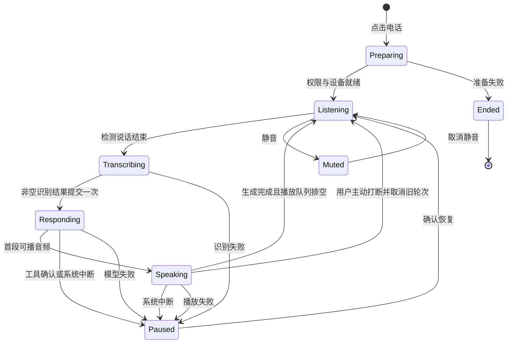

# 聊天页语音通话：视频分析与实现方案

日期：2026-11-11。状态：用户已授权实施；连续语音、聊天桥接与紧凑/展开界面已接入，验证结果以最终 CI 记录为准。

## 结论与范围

Ze 可以实现视频展示的「聊天页内免手持语音交流 + 文字记录 + 通话控制」。已有识别、语音活动检测、回复分句、系统/云端播报能力，主要新增工作是通话生命周期与音频协调。工程难度中等；稳定的扬声器双向抢话、回声消除和角色口型属于更高难度的独立层。

用户在方案评估后授权开始实施。入口位于聊天页右上角，紧挨齿轮左侧。现有顶部渐变、服务商图标、余额页面及输入方式保持原行为。

## 视频证据

参考文件：`C:\Users\Administrator\Desktop\eb41887081c7040adc802b31d3a6b452.mp4`。
SHA256：`bbb0bae1e1c047d5d8a153194fdaffcc9eeabe06c50a11a231ce33a7459e281b`。
1080 × 1920，约 29.989 fps，约 9.04 秒；元数据记载 271 帧，实际成功解码 270 帧。已按时间顺序检查五张连续帧表（覆盖全部可解码帧），并放大关键画面。帧表与关键原尺寸帧位于 `artifacts/tasks/fable52-v115-voice-review/`。

| 时间 / 帧 | 可见行为 |
| --- | --- |
| 0–0.67 秒 / 0–20 | 聊天页顶部是小圆头像，用户点击右上角电话入口。 |
| 0.70–1.10 秒 / 21–33 | 圆头像连续放大，右侧出现红色挂断与麦克风的竖向控制；仍在原聊天页。 |
| 1.1–3.7 秒 | 头像表情发生变化，底部输入栏与导航仍保留。仅画面不能确认声音驱动方式。 |
| 约 3.77–4.0 秒 / 113–120 | 紫色用户气泡由小变大出现，放大关键帧可见文字「哈啰在吗？」。 |
| 约 4.3–5.0 秒 / 129–150 | 左侧等待提示变成助手回复气泡，文字逐步增长。 |
| 5.0–8.5 秒 | 回复持续增长，头像有嘴部及表情变化。 |
| 8.54–8.97 秒 / 256–269 | 用户点击头像后，圆形头像放大成顶部宽幅圆角角色区域；右侧可见挂断、麦克风及 CC 控件。消息与输入栏仍在下方。 |

本次证据来自画面；未独立听辨音轨。视频未展示第二轮对话、抢话打断、锁屏、蓝牙切换、挂断后的资源释放，因此这些行为列入实现验收，不当作参考已证明的能力。角色动画可能来自 Live2D、视频或其他渲染方式，单凭画面不确定其内部技术。

## 现有代码与实际缺口

| 代码 | 现有能力 | 通话所需调整 |
| --- | --- | --- |
| `Views/Chat/AIChatView.swift` 的 `ChatToolbarHost`、`chatToolbarKey`、`trailingMenu` | 顶部工具栏做了 Equatable 更新隔离，齿轮由 UIKit 持久按钮承载 | 电话按钮作为同一 trailing 区域的独立按钮；只让通话状态进入比较键，音量/每个 token 不触发整个工具栏重建。 |
| `Providers/Voice/VoiceActivityDetector.swift` | AVAudioEngine、Silero/WebRTC APM、语音分段；配置可注入 | 单独创建通话配置，先以约 600–900 ms 尾部静音作为调试起点，实机调参；保留普通听写约 5 秒的默认值。短句「嗯」「好」应能提交。 |
| `Views/Chat/Voice/VoiceInputPanel.swift` 的 `VoiceInputViewModel` | 完整 WAV 转写、系统/云端服务商切换、听写纠错、输入框联动 | 复用下层识别接口，避免把通话直接绑到输入框、全局听写状态或普通听写的最短时长门槛。 |
| `Providers/Voice/VoiceProviderResolver.swift` | 当前 ASR/TTS 服务商解析及系统回退 | 通话启动时展示并固定本次配置；识别/播报配置与聊天推理模型分开。Fable 5.2 负责文本推理，不假设其具备直接音频接口。 |
| `Agent/Chat/AIChatViewModel+SSEStream.swift`、`AIChatViewModel.swift` | 当前会话发送、流式消息与分句播报 | 增加带会话/轮次标识的通话发送接口，不覆盖用户未发送草稿或附件；沿用真实会话、工具和权限确认路径。 |
| `Providers/Voice/VoiceOutputPlayer.swift`、`Agent/Chat/ChatURLBrokerage.swift` | 云端有序预取播放队列；系统 AVSpeechSynthesizer | 增加按通话/轮次识别的播放完成、失败、取消事件。等模型输出完成且所有音频排空再重新收音；一次句子结束或暂时缓冲为空不等于整轮结束。 |
| `Providers/Voice/AudioSessionCoordinator.swift` | 全 App 唯一音频会话所有者，录音 `.record/.measurement`，播报 `.playback/.spokenAudio` | 当前录音和播报互斥。第一版可顺序切换；双向通话需专门 `.playAndRecord/.voiceChat` 配置、回声处理及路由策略，仍由该协调器统一管理。 |

## 拟定交互

1. 齿轮左侧放电话图标，点按区域至少 44 × 44 pt；提供「开始语音通话」无障碍标签。点击后检查麦克风以及识别服务所需权限，再进入准备状态。权限未就绪时显示实际原因与设置入口。
2. 在当前聊天页顶部内容区出现紧凑通话区域，展示当前助手/服务商、计时与「正在听 / 正在识别 / 正在思考 / 正在说话」真实状态。聊天列表继续可滚动；标题栏及模糊背景沿用现有实现。
3. 提供麦克风静音与红色挂断；静音立即停止采集，保持通话。等待模型或播报期间提供明确的「打断并说话」动作，第一版用主动点击完成切换。
4. 用户说完自动识别和发送，识别结果成为当前会话的一条用户消息；助手边生成边按完整短句播报，回复同时保存为正常聊天消息。不朗读推理内容、原始工具参数或代码块。
5. 播报整轮完成后自动回到收音，持续多轮直至挂断。工具等待用户批准时停留于可操作的等待状态，避免不断监听产生新请求。
6. 点头像可在紧凑与展开的通话区域间过渡；采用同一视图身份及连续的几何/圆角动画，避免重建播放器和循环动画归零。首先采用当前助手图标及真实音量动效；视频级角色表情与口型作为独立可选模块，需要对应角色资源及音素/音量驱动方案。

## 生命周期与实现顺序

建议新增 `VoiceCallCoordinator`，使用明确状态和单一会话所有权，视图只订阅展示状态：

任意非终止状态均可挂断到 `Ended`；这是全局转换，图中省略重复箭头。每次启动和轮次产生唯一标识，异步回调先校验标识再更新状态。挂断必须取消识别/模型/合成任务、清空本通话的播放队列、停止采集并释放音频意图；迟到回调不得发送消息、播报或重新开启麦克风。所有状态在主 actor 串行推进，音频处理留在音频队列。

按下面三个可验收阶段推进：

- **第一阶段：连续语音闭环。** 实现独立协调器、现有 ASR → 当前模型 → TTS、自动恢复收音、静音/挂断/主动打断、会话记录、异常恢复。顺序收音/播报，覆盖系统与云端两条路径。
- **第二阶段：视频交互。** 接入指定工具栏位置、紧凑/展开通话区域、连续头像过渡、状态动效与计时、字幕可见控制；逐帧比较参考与录屏，回归当前导航和输入布局。
- **第三阶段：双向抢话与角色表现。** 增加回声消除、播放参考信号、扬声器/听筒/耳机路由、用户开口检测与旧轮次取消；再按可用角色资源接入口型。不能把简单音量跳动当作准确口型，也不能仅改音频 session category 就宣称完成双向通话。

## 验收清单与测量

- 状态测试：每段识别最多提交一次；短句可提交、静音不提交；旧回调被丢弃；模型仍在生成或合成队列未排空时不提前恢复收音；挂断后所有状态回调无副作用。
- 服务端错误测试：识别失败、空转写、模型拒绝/限流/超时、TTS 无音频/失败均显示真实状态，避免悄悄丢消息或无限重试。
- 连续交互：至少连续 20 轮，文字与音频顺序一致；按开始/挂断快速重复 20 次；切换会话、返回列表、切后台、系统来电、权限被撤销后无残留采集和播报。
- 音频实机：扬声器、听筒、有线耳机、AirPods 分别验证；播报声音不变成下一条用户消息；路由切换、静音、恢复后无卡死。双向版本再验证轻声抢话、背景噪声和回声误触发。
- 延迟日志：记录语音末尾、VAD 结束、转写完成、模型首段文字、TTS 首音频、实际开始播放及整轮完成时间。600–900 ms 是端点检测初始调参区间，不是整轮响应时延承诺。
- UI 与回归：电话严格在齿轮左侧；齿轮菜单在流式输出期间保持稳定；动态字体、小屏/iPad、深浅色、无障碍；普通听写、全局朗读开关、草稿/附件、工具审批与现有顶部渐变保持原行为。
- 构建与交付：最终提交 SHA 对应的 macOS 编译、自动化测试、IPA；模拟器验证布局；实机录屏与音频回环检验独立记录。Windows 静态检查不能替代音频实机验收。

工作量判断：UI 入口与收展动效较低到中等；稳定连续语音闭环中等；扬声器全双工、蓝牙中断恢复及精确角色口型较高。应先交付第一、二阶段的可验收版本，再用实机日志决定第三阶段的音频路线。
